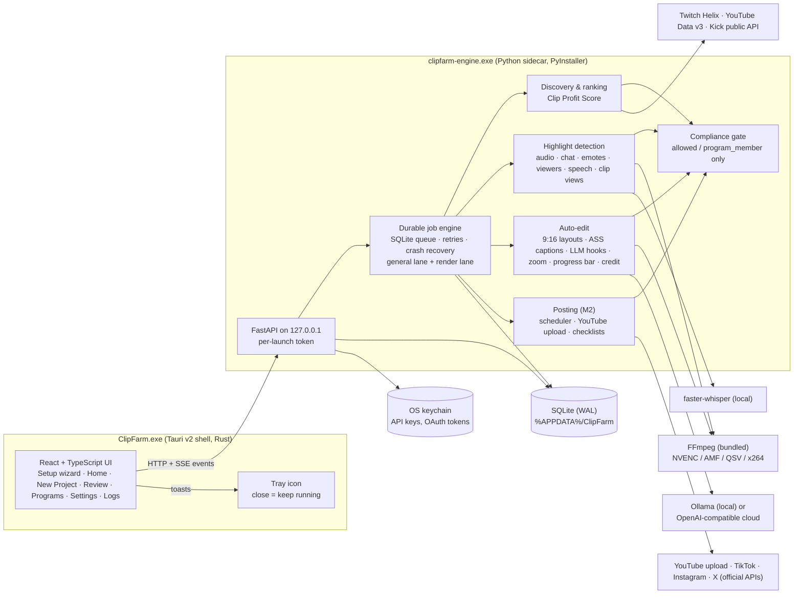

# ClipFarm — Architecture, Plan & Status

ClipFarm is a Windows-first desktop app that picks a game, finds and ranks the streamers playing it, detects highlight moments, edits them into vertical shorts with hooks and captions, and (from milestone 2) schedules them to the user's own accounts. Only streamers who allow clipping are processed.

---

## 1. Architecture



**Pipeline per project:** `project_tick` (every 10 min until the run ends) → `fetch_sources` per streamer (featured clips → community clips → VODs) → `process_source` (clips: trim & score; VODs: audio-only download → signal analysis → download only the winning sections) → `render_moment` (transcribe → hook/title via LLM → render with GPU) → Review screen → Export (MVP) / schedule & post (M2). A `cleanup` job enforces the storage cap.

## 2. Tech stack and why

| Layer | Choice | Why |
|---|---|---|
| Shell | **Tauri v2** (not Electron) | ~10 MB shell vs ~150 MB; built-in NSIS installer, signed auto-updater, tray, notifications, single-instance; sidecar support for the Python engine. |
| UI | React 18 + TypeScript + Vite | Requested; fast dev loop; huge ecosystem. |
| Engine | Python 3.12, FastAPI, frozen with PyInstaller | Best ecosystem for media/AI (faster-whisper, OpenCV, numpy, yt-dlp). Runs as a separate process so a crash in rendering never takes the UI down. |
| Video | FFmpeg (gyan.dev static build, bundled) | One tool for cutting, reframing, libass captions, loudness normalisation, and hardware encoding with CPU fallback. |
| Speech | faster-whisper (CTranslate2) | 4× faster than openai-whisper, runs on CPU int8 or CUDA; word timestamps for animated captions. |
| LLM | Ollama (default, local, free) or any OpenAI-compatible endpoint | Works offline and free; cloud is optional. If no model responds, template hooks keep the pipeline moving. |
| Storage | SQLite in WAL mode | Zero setup, single file, concurrent readers; the job queue lives here, so crash recovery is automatic. |
| Secrets | OS keychain via `keyring` | Windows Credential Manager / macOS Keychain; nothing secret on disk. |

## 3. Folder structure

```
clipfarm/
├─ app/                          # Desktop app (Tauri + React)
│  ├─ src/
│  │  ├─ App.tsx                 # nav shell, SSE -> desktop toasts
│  │  ├─ api.ts                  # local API client (token, media URLs)
│  │  ├─ pages/                  # Setup, Dashboard, NewProject, Review, Programs, Settings, Logs
│  │  └─ components/             # StreamerTable, ClipGrid (+ preview modal), Connections, Disclaimer
│  ├─ src-tauri/
│  │  ├─ src/main.rs             # sidecar spawn, tray, close-to-tray, kill on exit
│  │  ├─ tauri.conf.json         # NSIS installer, updater, bundled ffmpeg/font
│  │  └─ capabilities/default.json
│  └─ app-icon.png               # source for `npx tauri icon`
├─ backend/                      # Python engine
│  ├─ clipfarm/
│  │  ├─ schema.sql              # database schema
│  │  ├─ db.py config.py secrets.py compliance.py api.py main.py
│  │  ├─ providers/              # twitch.py youtube.py kick.py (official APIs)
│  │  ├─ discovery/              # ranking.py (Clip Profit Score), service.py
│  │  ├─ highlights/             # signals.py scorer.py dedupe.py transcribe.py chat_logger.py
│  │  ├─ editing/                # ffmpeg_util.py layout.py captions.py hooks.py render.py
│  │  ├─ jobs/                   # engine.py pipeline.py media.py storage.py
│  │  ├─ posting/                # scheduler.py youtube.py platforms.py
│  │  └─ llm/client.py
│  ├─ tests/test_core.py
│  ├─ run_engine.py              # PyInstaller entry
│  ├─ bin/  assets/fonts/        # ffmpeg + font (fetched by build script)
│  └─ requirements.txt
├─ scripts/build_windows.ps1     # one-command local installer build
├─ .github/workflows/release.yml # tag -> signed installer + updater manifest
└─ docs/ARCHITECTURE.md
```

## 4. Database schema (summary — full DDL in `backend/clipfarm/schema.sql`)

| Table | Purpose |
|---|---|
| `settings` | JSON key/value app settings (non-secret) |
| `games` | chosen games with per-platform ids |
| `streamers` | one row per channel per platform; **`permission_status`** (allowed / program_member / unknown / prohibited) + source note; best posting avenues |
| `streamer_snapshots` | viewers/followers over time → averages and growth trend |
| `programs`, `streamer_programs` | user-editable rewards programs: payout/1k, min views, required tags/credit/disclosure, rules |
| `rankings` | cached Clip Profit Score and its components per streamer × game |
| `projects`, `project_streamers` | runs with duration, status, and output settings |
| `sources` | clips/VODs pulled per streamer, local file, lifecycle status |
| `moments` | scored candidate highlights with signal breakdown + dedupe fingerprint |
| `clips` | rendered shorts: hook, title, description, hashtags, layout, content hash, review status |
| `accounts`, `posts`, `post_metrics` | connected social accounts, scheduled/posted uploads (unique per clip × account), metrics over time |
| `payouts` | estimated / pending / approved / paid per program |
| `jobs` | durable job queue (status, progress, ETA, attempts, backoff) |
| `logs` | the Logs screen |

## 5. Clip Profit Score

`score = 0.30·audience + 0.30·payout + 0.15·low-competition + 0.15·highlight-frequency + 0.10·growth` (0–100)

- **audience** — log-scaled average viewers (10 → 0.2, 1k → 0.6, 100k → 1.0)
- **payout** — best linked program's rate per 1k views ($3+ = max); allowed-but-unpaid = 0.15
- **competition** — your estimate of other clippers covering them (unknown = neutral)
- **highlight frequency** — community clips per stream-hour (proxy for "how clippable")
- **growth** — last-24h vs previous-6-days average viewers
- **Prohibited = 0 and hidden; Unknown = score halved and not selectable** until you record permission or link a program.

## 6. Highlight detection

Per-second signals → rolling z-score (5-min window, so a loud streamer isn't "always exciting") → sigmoid to 0–1 → weighted composite (audio 0.35, chat 0.30, emotes 0.20, speech 0.10, viewers 0.05; missing signals are skipped and weights renormalised). Greedy peak picking with non-maximum suppression keeps the top N per stream-hour above the user threshold; each window grows to the region above 70% of the peak plus padding, clamped to min/max length. Nearby community clips boost a moment's score. Dedupe fingerprints moments by streamer + wall-clock 30 s bucket (±1 bucket), so the same moment found via a clip and via the VOD is only made once.

## 7. Milestones

| # | Scope | Status in this delivery |
|---|---|---|
| **M1 MVP** | Setup wizard (disclaimer, storage, keys, GPU check) · game picker · Twitch/YouTube/Kick discovery · ranking table + cards · programs DB · permission gate · durable job engine with pause/resume/stop & crash recovery · clip + VOD highlight detection · auto-edit (3 layouts, animated captions, LLM hooks, zoom, progress bar, credit, loudness) · review/approve · manual export with caption file · storage cap · tray + toasts · logs · NSIS installer built in CI | **Built.** Engine tested; UI checked in a browser; installer built by GitHub Actions (`.github/workflows/build.yml`) |
| **M2 Posting** | Wire `scheduler.plan_slots` + `posts` table into a `post` job; YouTube upload (adapter built) · TikTok Content Posting API · Instagram Graph API (Reels) · X API · metrics polling job · auto-apply program tags/credit/disclosure (done at render time) · submission checklist (built) | Adapter + scheduler + checklist built; job wiring and other platforms to do |
| **M3 Analytics** | Per-clip/streamer/game/platform charts · payout tracker UI (pending/approved/paid) · "what's working" (hook style, length, posting time, streamer) · refit score weights from your own results | Schema ready; UI to do |
| **M4 Polish** | macOS build · manual facecam box editor · re-render after hook edit · live-stream recording · royalty-free music library picker · more caption themes · API contract tests | To do |

## 8. Testing plan

1. **Unit / integration (automated, `pytest`)** — ranking order & permission rules, planted-spike highlight detection, chat hype counting, dedupe buckets, permission gate, ASS caption timing, scheduler constraints, job engine retry + crash recovery, real FFmpeg renders in all layouts (1080×1920, duration, audio, thumbnail, hash), the full `render_moment` handler (program tags, credit, disclosure, export), and blocking unpermitted streamers. **15/15 passing.**
2. **API contract tests** — FastAPI `TestClient` for every route incl. token auth and media path traversal (M4).
3. **Clean-machine installer QA** — fresh Windows 10 and 11 VMs, no Python/Node: install → wizard → first clip without a terminal; repeat on NVIDIA, AMD, Intel-only, and no-GPU machines to confirm encoder choice and CPU fallback.
4. **Soak test** — 24 h project on 3 live streamers; watch memory, disk cap enforcement, and job backlog.
5. **Chaos** — kill the engine mid-render and reboot mid-project; confirm jobs resume and no duplicate clips are made.
6. **Compliance** — try to select/clip unknown and prohibited streamers through the UI and API; both must be refused.
7. **CI** — every push runs the tests, freezes the engine, starts it and checks it answers, then builds the installer.

## 9. Known limitations and risks (read these)

- **Unsigned installer.** Windows SmartScreen warns on first run until the app is code-signed. Auto-update is not included in v0.1.
- **Video downloading isn't an official API.** Twitch, YouTube and Kick don't offer official clip/VOD download endpoints for third parties, so ClipFarm uses `yt-dlp`. Platform terms generally restrict downloading, which is why the permission gate is hard-wired: only streamers whose program or explicit permission covers re-editing their content. Check each program's rules.
- **No VOD chat on Twitch.** Twitch has no official API for past chat, so the chat signal only exists for streams ClipFarm was logging live (anonymous read-only IRC). VODs analysed without a log rely on audio + clip views.
- **Platform API gates for posting (M2):** TikTok's Content Posting API needs an approved developer app (unaudited apps can only post privately); Instagram Reels publishing needs a Business/Creator account linked to a Facebook Page and a publicly reachable video URL; X posting needs a paid API tier; a YouTube upload costs ~1,600 of the default 10,000 daily quota units (~6 uploads/day per Google Cloud project).
- **YouTube discovery quota:** each search costs 100 units, so YouTube discovery is cached.
- **Rewards programs have no common API.** Program data is manual/community; auto-submission is only possible where a program offers an API, otherwise the checklist is generated.
- **"Other clippers covering them" is your estimate**; there's no reliable public source.
- **Facecam detection** is a Haar-cascade heuristic (saved per streamer once found); action tracking follows motion, not objects. A manual box editor is planned.
- **Follower counts** on Twitch may need a user token; they show "—" if refused.
- **Earnings tiers are coarse estimates from public viewer counts**, labelled as such everywhere.

---

## v0.2 additions (19 Nov 2026)

| Area | Where | What |
|---|---|---|
| Migrations | `backend/clipfarm/migrations.py` | Additive only (v2 columns/tables, v3 seed). Runs on every start; existing rows kept. |
| Keys | `secrets.py`, `vault.py` | Credential Manager ("ClipFarm") + DPAPI vault `%APPDATA%\ClipFarm\vault.dat`, restored on start; password export/import (scrypt + AES-GCM). |
| Redaction | `redact.py` | Known secret values + token/key patterns scrubbed from logs, job errors, diagnostics, engine.log. |
| Setup Health | `health.py`, `netcheck.py`, `pages/Health.tsx` | Green/yellow/red checks with fixes; run quietly on start; banner; diagnostics file. |
| Campaigns | `campaigns/` (`seed`, `importer`, `matching`, `fields`) | Paste-to-import (no public API), channel matching with confirmation, "needs confirming" flags. |
| Projections | `campaigns/forecast.py` | Port of `market_forecast.py`: per streamer × campaign × platform, AUD low/likely/high, per clip/day/7d/30d, A$/PC-hour; refit after 2 weeks. |
| Auto-pilot | `campaigns/autopilot.py` | Status refresh, plan within limits, switch log, drives the "Auto-pilot" project with per-streamer quotas. |
| Render rules | `campaigns/rules.py` | Tags/credit/disclosure in the caption; overlay/face rules pick a safe layout or flag for review. |
| Posting | `posting/submissions.py` | Scheduling with safety rules, manual post links, one submission per post, payouts. |
| Shell | `app/src-tauri/src/main.rs` | Engine watchdog (restart with back-off), resource dir, updater plugin. |
| Installer | `app/src-tauri/windows/hooks.nsh` | Uninstall keeps data unless "Delete the application data" is ticked; then wipes keys + data. |
| CI | `.github/workflows/build.yml` | Contract + e2e tests, frozen-engine smoke test, silent install + `--self-test` with no Python/FFmpeg on PATH, optional signed updates. |

Clip Profit Score: the payout part now uses projected A$ per PC-hour (`AUD_PER_HOUR_MAX = 20` = full marks) when a
campaign projection exists. Streamers without an active campaign are "no payout": auto-pilot never clips them and
manual clipping asks for confirmation (`confirm_no_payout`).
